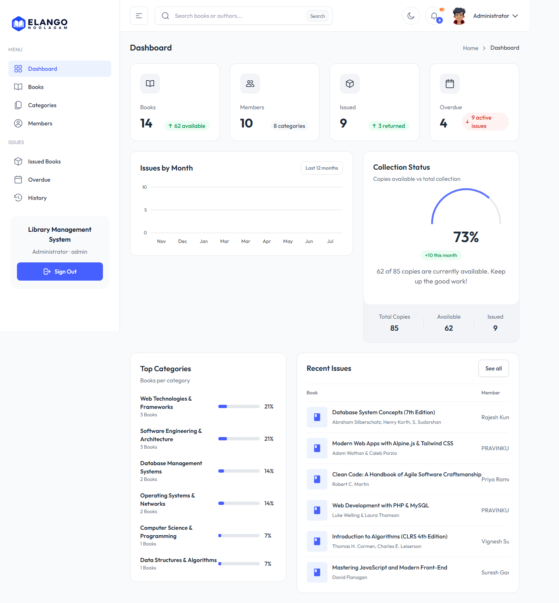
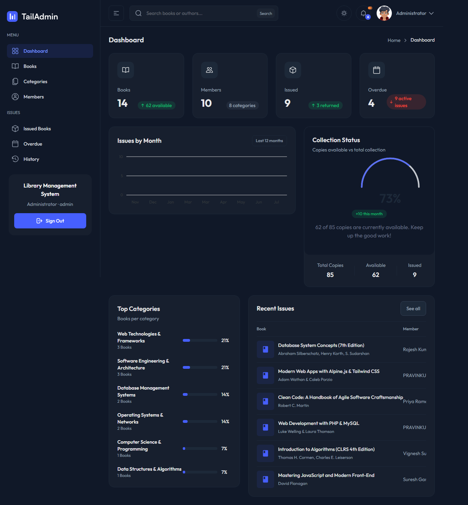
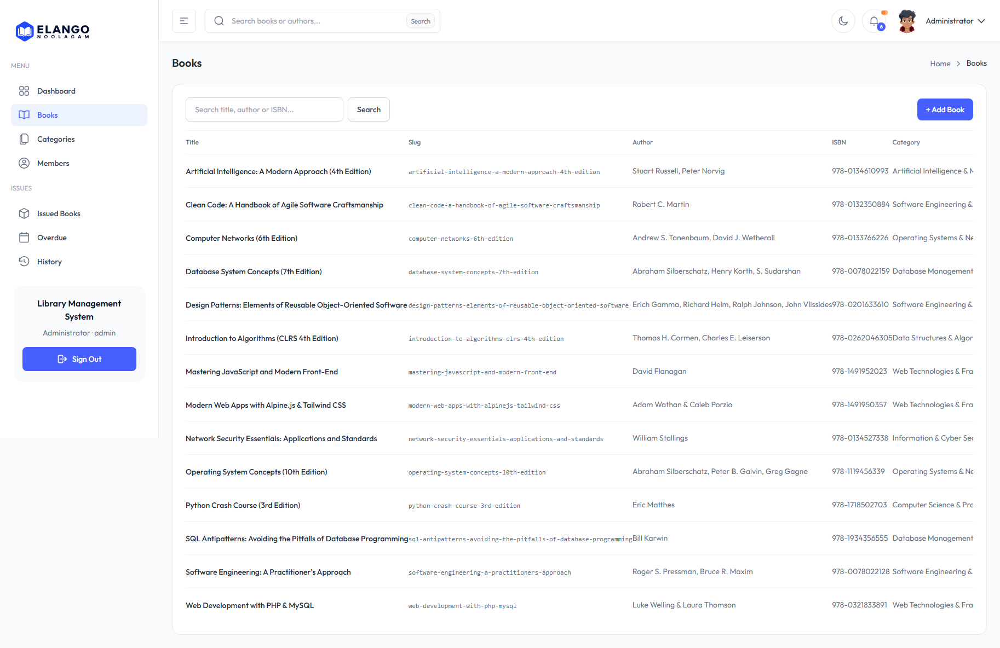
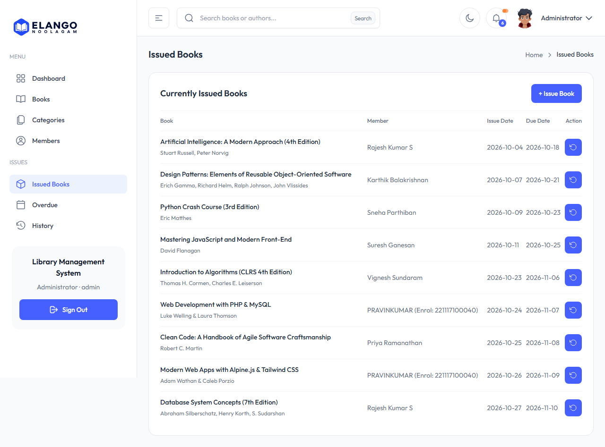
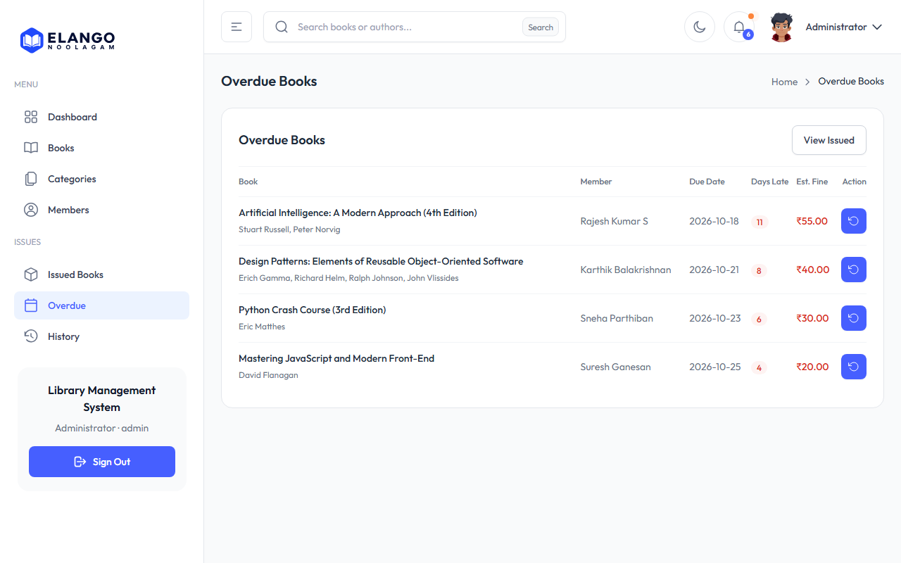
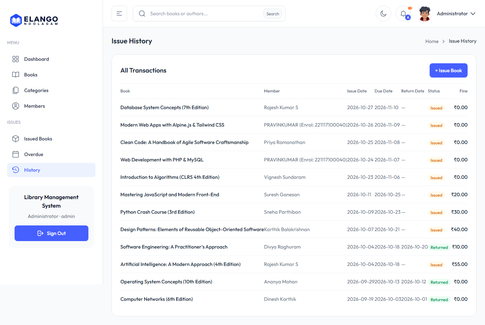

# Library Management System

A modern, full-stack **Library Management System** built with **PHP 8**, **CodeIgniter 3 (HMVC-ready MVC)**, **BladeOne** template engine, **Tailwind CSS v4**, **Alpine.js**, and the **TailAdmin** design system. 

The application is pre-configured with a self-contained **SQLite 3** database for zero-setup execution, and includes a full **MySQL 8.x** relational schema for production deployment.

---

## Key Features

- **Executive Analytics Dashboard:**
  - Real-time library metrics (Total Books, Registered Members, Active Issues, Overdue Defaulters).
  - Interactive monthly circulation trends chart powered by **ApexCharts**.
  - Radial collection utilization gauge and top borrowing categories breakdown.
  - Notification center with quick-action transaction alerts.

- **Catalog & Inventory Management:**
  - Complete Book Catalog with real-time search, category filtering, and inventory status badges.
  - Automatic URL slugification, ISBN uniqueness enforcement, and stock level controls.
  - Categorization system with book count aggregation.

- **Member Administration:**
  - Member onboarding and record management.
  - Instant membership status toggling (Active / Inactive) and borrow eligibility checks.

- **Circulation Desk Operations:**
  - Rapid Book Issue desk with real-time member and book availability verification.
  - Atomic inventory decrement upon book issue.
  - 14-day default borrowing window with customizable return dates.
  - Book return processing with atomic copy restoration.

- **Automated Overdue & Penalty Engine:**
  - Automatic tracking of overdue borrowings.
  - Dynamic fine calculation based on elapsed overdue days.
  - Overdue notification alerts for delinquent accounts.

- **Audit & Historical Records:**
  - Full issue and return transaction history with member and book relational joins.
  - Return status timestamps and overdue fine audits.

- **Modern Responsive UI / UX:**
  - Utility-first styling via **Tailwind CSS v4** and **TailAdmin** component system.
  - Full **Dark Mode** support with smooth Alpine.js reactive store toggling.
  - Single-page responsiveness across desktop, tablet, and mobile viewports.

---

## Tech Stack & Architecture

| Layer | Technology | Description |
|---|---|---|
| **Backend Runtime** | PHP 8.2+ | Strict typing, OPcache JIT compilation, secure password hashing |
| **MVC Framework** | CodeIgniter 3.x | Lightweight MVC, Active Record Query Builder, Session management |
| **Template Engine** | BladeOne (EFTEC) | Laravel Blade syntax, template inheritance (`@extends`, `@section`) |
| **Frontend Framework** | Alpine.js 3.x | Declarative, lightweight reactive state management |
| **Styling & Design** | Tailwind CSS v4 & TailAdmin | Modern utility-first responsive layout with dark mode |
| **Data Visualization** | ApexCharts.js | Interactive circulation analytics and radial collection charts |
| **Database Engine** | SQLite 3 / MySQL 8.x | Zero-config local SQLite + production MySQL DDL schema |

---

## Screenshots

<div align="center">

### Executive Dashboard (Light & Dark Theme)
<p float="left">
  
  
</p>

### Book Catalog & Circulation Desk
<p float="left">
  
  
</p>

### Overdue Fines & Issue History
<p float="left">
  
  
</p>

</div>

---

## Quick Start & Installation

### Prerequisites
- **PHP 8.1+** with `pdo_sqlite` and `mbstring` extensions enabled.
- **Node.js 18+** & **npm** (for building frontend assets).
- **Composer** (optional, dependencies are pre-bundled).

### Setup Instructions

1. **Clone the repository:**
   ```bash
   git clone https://github.com/pravinkumarravi/library-management-system.git
   cd library-management-system
   ```

2. **Install frontend dependencies & compile assets:**
   ```bash
   npm install
   npm run build
   ```

3. **Database Setup:**
   The SQLite database is pre-configured and located at `application/db/library.sqlite`.
   To run or verify CLI migrations:
   ```bash
   php index.php migrate
   ```

4. **Start the local PHP server:**
   ```bash
   php -S localhost:8000
   ```

5. **Open in browser:**
   Navigate to `http://localhost:8000`

---

## Default Credentials

| Role | Username | Password | Access Level |
|---|---|---|---|
| **Administrator** | `admin` | `admin123` | Full access to catalog, members, circulation, and reports |

---

## Project Structure

```
library-management-system/
├── application/
│   ├── config/            # CI3 configuration (database, routes, migrations)
│   ├── controllers/       # MVC Controllers (Auth, Books, Categories, Members, Issues, Dashboard)
│   ├── core/              # Base App_Controller and App_Model
│   ├── db/                # SQLite database storage (library.sqlite)
│   ├── helpers/           # BladeOne view helpers and view renderer
│   ├── libraries/         # Custom BladeOne library integration
│   ├── migrations/        # Database schema migrations (001 - 006)
│   ├── models/            # Relational models (Book, Category, Issue, Member, User)
│   └── views/             # Blade templates (layouts, auth, dashboard, books, issues, members)
├── assets/
│   ├── css/               # Tailwind CSS v4 source and compiled app.min.css
│   ├── js/                # Alpine.js, ApexCharts, and dashboard scripts
│   └── images/            # UI icons, avatars, and application branding
├── docs/
│   └── screenshots/       # Application walkthrough screen captures
├── sql/
│   └── library.sql        # MySQL 8 relational schema and seed records
├── package.json           # Frontend build scripts (Tailwind & Rollup)
└── README.md              # Project documentation
```

---

## Database Migrations (CLI)

Database migrations are managed via CodeIgniter CLI:

```bash
# Migrate to latest schema version
php index.php migrate

# Rollback or migrate to specific version
php index.php migrate version 3
```

---

## License

This project is open-source and available under the [MIT License](LICENSE).
